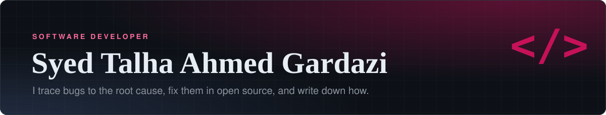
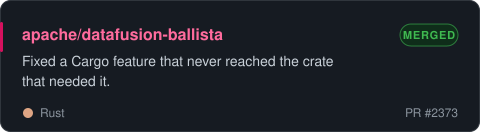
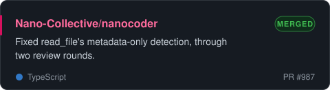
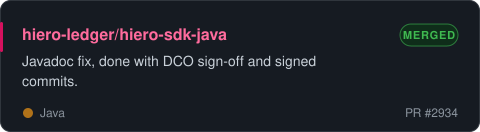
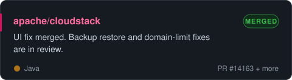
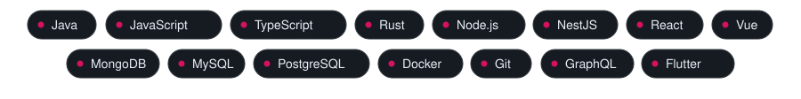
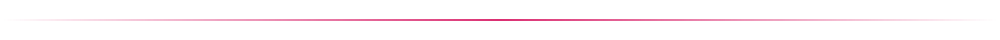

  

   
 

 

Hi, I'm Talha. I'm a software developer at Bank Al Habib, with a BS in Computer Science from IBA Karachi on a full scholarship, and I'm currently doing an MSc at ELTE.

Outside work I send fixes to open source projects and write up what I find: the bug, how I traced it, and what the maintainers said in review. So far that's merged PRs in Apache DataFusion Ballista, Apache CloudStack, nanocoder and the Hedera Java SDK, with more in review at CloudStack.

## Open source

## Stack

## Writing

I write [Bug Brewery](https://blogs.gardazi.com), field notes from real debugging and open source work.

- [Two Weeks of Real Open Source Contributions](https://blogs.gardazi.com/two-weeks-of-real-open-source-contributions/)
- [How to Tell If a Project Will Merge Your PR](https://blogs.gardazi.com/how-to-tell-if-a-project-will-merge-your-pr/)
- [A Beginner's Glossary to Pull Requests](https://blogs.gardazi.com/a-beginners-glossary-to-pull-requests/)
- [A Check That Could Never Be True](https://blogs.gardazi.com/a-check-that-could-never-be-true/)

